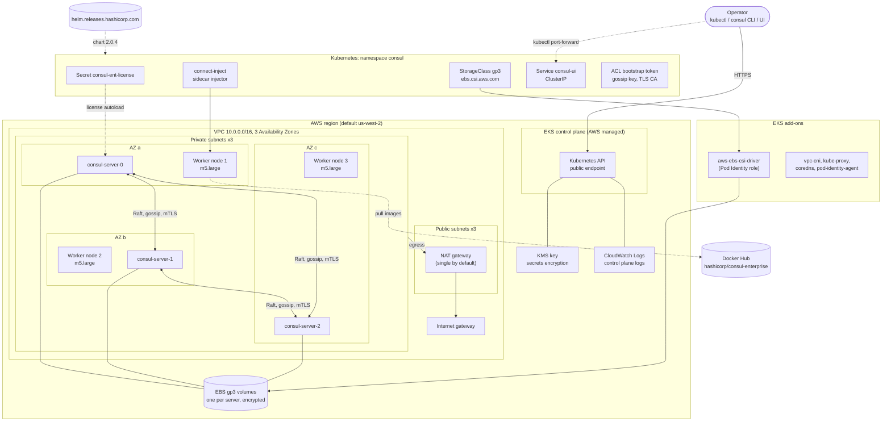

# consul-eks

Terraform that deploys **Consul Enterprise** on **Amazon EKS**: a new VPC, an EKS cluster with
managed nodes, the EBS CSI driver, and the official Consul Helm chart with TLS, ACLs and gossip
encryption enabled.

## Architecture



### What gets created

| Layer | Resources | Defined in |
|-------|-----------|------------|
| Network | VPC, 3 public and 3 private subnets, internet gateway, NAT gateway | [`main.tf`](main.tf) |
| Cluster | EKS control plane, KMS key, CloudWatch log group, OIDC provider, managed node group (3 x `m5.large`, AL2023) | [`main.tf`](main.tf) |
| Add-ons | `vpc-cni`, `kube-proxy`, `coredns`, `eks-pod-identity-agent`, `aws-ebs-csi-driver` with an IAM role via EKS Pod Identity | [`main.tf`](main.tf) |
| Storage | Encrypted `gp3` StorageClass with `WaitForFirstConsumer` | [`consul.tf`](consul.tf) |
| Consul | Namespace, license Secret, Helm release `hashicorp/consul` | [`consul.tf`](consul.tf), [`consul-values.yaml`](consul-values.yaml) |

### Design notes

- **Three servers, one per AZ.** A required pod anti-affinity rule on `topology.kubernetes.io/zone`
  keeps Raft quorum through the loss of a single zone. Keep `node_count` at 3 or more.
- **Nodes are private.** Workers sit in private subnets and reach the internet through the NAT
  gateway. The cluster API endpoint is public; restrict it with `endpoint_public_access_cidrs` in
  `main.tf` for anything beyond a demo.
- **Single NAT gateway by default** to save cost. Set `single_nat_gateway = false` for one per AZ.
- **Secure by default.** TLS, `manageSystemACLs` and auto-generated gossip encryption are on.
- **The UI is `ClusterIP`.** Reach it with `kubectl port-forward`; put an internal load balancer
  or ingress in front of it for shared use.

## Prerequisites

- Terraform >= 1.9
- AWS CLI and credentials that can create VPC, EKS, IAM and KMS resources
- A Consul Enterprise license file (`.hclic`)
- `kubectl` and, optionally, the `consul` CLI

## Usage

```bash
cp terraform.tfvars.example terraform.tfvars   # set consul_license_file
terraform init
terraform plan -out=tfplan
terraform apply tfplan
```

Provisioning takes roughly 15 to 20 minutes. Then:

```bash
$(terraform output -raw kubeconfig_command)
kubectl get pods -n consul

export CONSUL_HTTP_TOKEN=$($(terraform output -raw consul_token_command))
kubectl port-forward -n consul svc/consul-ui 8501:443 &
CONSUL_HTTP_ADDR=https://localhost:8501 CONSUL_HTTP_SSL_VERIFY=false consul license get
```

`consul members` should list three servers whose build ends in `+ent`.

## Inputs

| Variable | Default | Description |
|----------|---------|-------------|
| `consul_license_file` | none (required) | Path to the `.hclic` license file |
| `region` | `us-west-2` | AWS region |
| `name` | `consul-ent` | Name prefix for the VPC and cluster |
| `kubernetes_version` | `1.33` | EKS Kubernetes version |
| `vpc_cidr` | `10.0.0.0/16` | VPC CIDR |
| `single_nat_gateway` | `true` | One NAT gateway (cheap) or one per AZ (HA) |
| `node_instance_types` | `["m5.large"]` | Worker instance types |
| `node_count` | `3` | Worker nodes |
| `consul_version` | `2.0.4` | Consul Enterprise version and Helm chart version |
| `consul_namespace` | `consul` | Kubernetes namespace |
| `consul_datacenter` | `dc1` | Consul datacenter name |
| `consul_server_replicas` | `3` | Consul servers |
| `tags` | `{}` | Extra tags for AWS resources |

## Security

- **The license is stored in Terraform state** as a Kubernetes Secret value. Use an encrypted
  remote backend (for example S3 with KMS and locking) rather than local state.
- `*.hclic`, `terraform.tfvars`, state files and plan files are git-ignored. Never commit them.
- Do not publish a plan file or `apply.log`; both can contain sensitive values.

## Cost

Roughly $0.40 to $0.50 per hour while running: the EKS control plane, three `m5.large` nodes, one
NAT gateway and EBS volumes. Check current AWS pricing for your region.

## Cleanup

```bash
terraform destroy
```

Delete the `consul` namespace's PVCs first if destroy stalls on EBS volumes.
